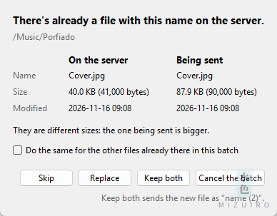

# KaiDrop

<p align="center"></p>

A Windows app that **sends music (or anything) from your computer to a
Switch 2 running kaiHEN, over FTP**, with file names the console can actually
list. It looks like FileZilla: your computer on the left, the console on the
right. It works with any FTP server; on the console, use OunceShell's.

Tested on a Switch 2 with OunceShell's FTP server: over a gigabyte of
music, and a transfer cut halfway and continued after reconnecting.


*KaiDrop: this computer on the left, the console on the right.*



*When a file is already on the console, KaiDrop asks what to do.*

## What it can do

- **Plain names for Switch 2.** The console hides files and folders whose
  names have accents or other non-ASCII characters, in every app. KaiDrop
  gives the copies on the console names it can list: `06 Canción.flac`
  becomes `06 Cancion.flac`, and Japanese, Chinese, Korean or other
  alphabets are written in Latin letters (`水色.mp3` becomes `Mizuiro.mp3`).
  **Your files on the computer are never renamed or changed.**
  [More](docs/plain-names.md)
- **Playlists keep working**: the copy of an `.m3u`, `.m3u8` or `.pls` on
  the console points to the songs' plain names.
  [More](docs/plain-names.md#playlists-keep-working)
- **Send and receive** folders and files, keeping the folder structure, by
  dragging between the two sides, from Explorer, or with right-click.
  [More](docs/using-it.md#send-and-receive)
- **Shows the names before sending**: each file's name on your computer and
  on the console, renamed ones in color.
  [More](docs/using-it.md#the-transfers-tab)
- **Asks when a file is already there**: Skip, Replace, Keep both or Cancel
  the batch, for that file or for every one in the batch.
  [More](docs/using-it.md#a-file-already-there)
- **Manage files on the console**: new folder, rename, delete, cut, copy and
  paste. [More](docs/using-it.md#on-the-console)
- **Survives a lost connection**: it notices when the server goes away,
  offers **Reconnect** and continues with the files left. A half-sent file
  never looks whole. [More](docs/using-it.md#connection-lost)
- **Speed and time left** while moving files, and a **Log** tab like
  FileZilla's message log. [More](docs/using-it.md#the-transfers-tab)
- **Remembers** the console's address and the destination folder.

## Install

1. Get `KaiDrop.exe` (Windows) from
   [Releases](https://github.com/mizuiroame/kaidrop/releases). It needs
   nothing else installed.
2. On the console, open **OunceShell** and start its **FTP server**.
3. Open **KaiDrop**, type the address and port the console shows, and press
   **Connect**. See [Using KaiDrop](docs/using-it.md).

On macOS or Linux, run it from source with Python 3.10 or later (Tkinter
included):

```
pip install pypinyin anyascii      # for Chinese and other alphabets' names
python -m kaidrop
```

## Documentation

- [Plain names for Switch 2](docs/plain-names.md): why names with accents
  vanish on the console, and how KaiDrop renames the copies
- [Using KaiDrop](docs/using-it.md): connecting, browsing, sending and
  receiving, the Transfers and Log tabs, reconnecting
- [For developers](docs/developers.md): tests, building the .exe, what each
  file does
- [Security](SECURITY.md): plain FTP, what's kept, checking the download,
  and how to report a problem

## Legal notice

KaiDrop is an independent open-source project. It is not affiliated with,
endorsed by or sponsored by Nintendo. "Nintendo Switch" and "Switch 2" are
trademarks of their respective owners, used only to describe the hardware
this software works with. KaiDrop is a general FTP client: it copies only
the files you choose, to a server you run. See [LICENSE](LICENSE).

## License

MIT. Copyright (c) 2026 Mizuiro.

`KaiDrop.exe` includes Python, Tcl/Tk, tkinterdnd2, TkDND, pypinyin,
anyascii and a list of readings made from UniDic, each under its own license:
see [third_party/](third_party/).
