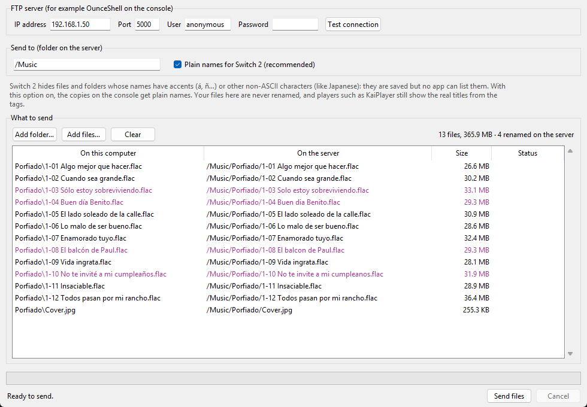

# KaiDrop

**Send music (or anything) from your computer to a Switch 2 running kaiHEN,
over FTP — with file names the console can actually list.**



## The problem

On Switch 2, a file or folder whose name has a character outside basic
ASCII — an accented letter such as **á, é, ñ, ü**, typographic quotes such as
**’**, or Japanese, Chinese or Korean — is saved to the SD card, but the
console's directory listing leaves it out. Every app is affected: FTP
listings, OunceShell's file browser, KaiPlayer and any other homebrew. The
file takes up space but nothing can see it.

So `06 Canción.flac` uploaded with FileZilla is invisible, while
`06 Cancion.flac` works.

## What KaiDrop does

- Sends folders and files over FTP, keeping the folder structure. It works
  with any FTP server; on the console, use OunceShell's.
- With **Plain names for Switch 2** on (the default), it gives each copy on
  the console a name it can list:
  - accents are dropped: `Canción` → `Cancion`, `Ñandú` → `Nandu`;
  - typographic punctuation becomes plain: `Why’d` → `Why'd`, `–` → `-`;
  - other characters, like Japanese, become `_`: `04 みずいろの雨.mp3` →
    `04 _.mp3`;
  - names that would clash get a number: `Cancion (2).mp3`.
- **Your files on the computer are never renamed or changed.** Only the
  copies on the console get the new names.
- Shows, before sending, each file's name on your computer and on the
  console (renamed ones in color).
- Skips files already on the console with the same size, so you can send a
  folder again after adding songs, or resume a stopped upload.
- Remembers the console's address and the destination folder.

Music players such as [KaiPlayer](https://github.com/mizuiroame/kaiplayer)
read the title, artist and album from the songs' tags, so they still show
**Canción** with its accent, or the Japanese title, whatever the file is
called.

## Use it

1. On the console, open **OunceShell** and start its **FTP server**. Note
   the IP address and port it shows.
2. On your computer, open **KaiDrop**:
   - Type the **IP address** and **port** (and the user and password, if
     your server asks for them). **Test connection** checks them.
   - In **Send to**, type the folder on the SD card, for example `/Music`.
   - **Add folder…** or **Add files…**. The list shows where each file goes.
3. Press **Send files**. The progress bar and the **Status** column
   show how it goes; **Cancel** stops it (a half-sent file is removed).

## Download

Get `KaiDrop.exe` (Windows) from
[Releases](https://github.com/mizuiroame/kaidrop/releases). It needs nothing
else installed.

On macOS or Linux, run it from source with Python 3.10 or later (Tkinter
included):

```
python -m kaidrop
```

## For developers

```
python -m unittest discover -s tests -t .          # tests (FTP tests need pyftpdlib)
pip install -r requirements-dev.txt                # pyftpdlib and PyInstaller
powershell -File build.ps1                         # builds dist/KaiDrop.exe
```

| File | What it does |
|------|--------------|
| `kaidrop/names.py` | The plain names for the console |
| `kaidrop/plan.py` | What goes where: the files and their names on the console |
| `kaidrop/ftp.py` | The upload: folders, skipping, progress, cancel |
| `kaidrop/app.py` | The window (Tkinter) |
| `kaidrop/settings.py` | Remembers the address and folder (never the password) |

## Legal notice

KaiDrop is an independent open-source project. It is not affiliated with,
endorsed by or sponsored by Nintendo. "Nintendo Switch" and "Switch 2" are
trademarks of their respective owners, used only to describe the hardware
this software works with. KaiDrop is a general FTP client: it copies only
the files you choose, to a server you run. See [LICENSE](LICENSE).

## License

MIT. Copyright (c) 2026 Mizuiro.
