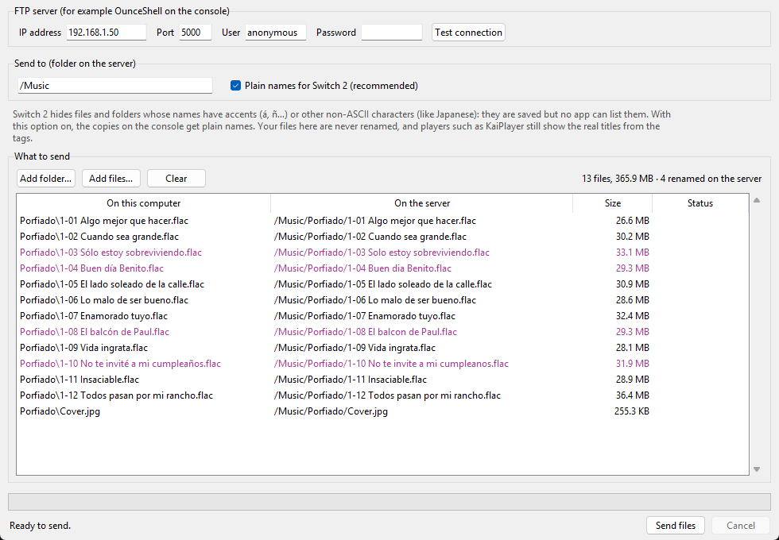
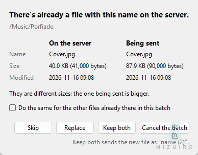

# Using KaiDrop

[Back to the README](../README.md)

## Connect

1. On the console, open **OunceShell** and start its **FTP server**. Note
   the IP address and port it shows.
2. On your computer, open **KaiDrop**, type the **Host** (the IP address)
   and **Port** (and the user and password, if your server asks for them),
   and press **Connect**.

KaiDrop works with any FTP server; on the console, use OunceShell's. It
remembers the console's address and the destination folder (never the
password).

### Faster with SW2Transfer

If the console runs [SW2Transfer](https://github.com/Rodpad/SW2Transfer)
(the app, or its background plugin), KaiDrop moves the files' bytes through
it: each big file goes in 2 MB pieces over 8 connections at once, about five
times faster than FTP (SW2Transfer measured about 50 MB/s up and 40 down on
Wi-Fi). Nothing to set up:

- Connect as usual, to OunceShell's FTP or to SW2Transfer's own (port
  **6700**). Browsing, folders and the questions about files already there
  stay on FTP.
- When a batch starts, KaiDrop looks for SW2Transfer on the same address
  (port 6967) and checks that it shows the same folders as the FTP server.
  The Log tab says when it's used ("SW2Transfer … found").
- If SW2Transfer has a password, type it as the FTP password: KaiDrop signs
  in to both with it. If it's wrong for SW2Transfer, KaiDrop says so in the
  Log and sends over FTP.
- **Cancel all** on the console (or in SW2Transfer's web page) stops KaiDrop's
  batch too, and the unfinished file is removed. Files still arrive as
  `.part` and get their name when whole.
- Playlists' copies still go over FTP (they're small).

## Browse

KaiDrop looks like FileZilla: **your computer on the left, the console on
the right**.

- On the left, a folder tree like Explorer's starts from Desktop, Documents,
  Downloads, Music and your drives (by name, such as *Data (D:)*); the
  folder's contents are below it.
- Browse both sides: double-click a folder, **↑** goes up, or type a path and
  press Enter.
- **Right-click** for more:
  - on the left: *Send to the server*, *Open*, *New folder* and *Refresh*;
  - on the right: *Open*, *Cut* (Ctrl+X), *Copy* (Ctrl+C), *Paste* (Ctrl+V;
    on a folder, *Paste into* it), *New folder*, *Rename* (F2), *Delete*
    (Del) and *Refresh* (F5).

## On the console

- With plain names on, folders made or renamed on the console get plain
  names too. See [Plain names](plain-names.md).
- **Moving on the console** (cut and paste, or dragging onto one of its
  folders) is instant.
- **Copying** goes through your computer, since FTP can't copy on the
  server: each file comes down and goes back up, so a big video takes as long
  as sending it.
- A name already there gets a free one (*name (2)*), and a folder can't go
  into itself.
- **Deleting a folder with hidden files.** The console leaves names with
  accents, Japanese and other non-English letters out of its listings (files
  sent by other programs without plain names), so such a folder never looks
  empty. KaiDrop deletes those files by name, taken from the folder of the
  same name open on the left; if there isn't one, it asks you to pick the
  folder they were sent from. Nothing on your computer is changed.

## Send and receive

Folders and files keep their folder structure, both ways.

- **Send** files or folders by **dragging them from the left onto the right**
  (onto a folder to send them into it), by dragging them from Explorer, or
  with **right-click → Send to the server**.
- **Receive** them the other way: drag from the right onto the left, or
  **right-click → Download to this computer** (into the folder shown on the
  left).
- While you drag, a label by the pointer shows what you're moving and where
  it will land, and the folder under the pointer lights up.

### Selecting

- Dragging **up or down inside a list selects** the files and folders you go
  over (with **Ctrl** they're added to the others; past the top or bottom the
  list scrolls).
- The selection is **moved once the pointer leaves the list** toward the
  other side (brought back over one of the server's own folders, it moves
  there).
- Select several as in Explorer too: **Ctrl+click** adds or removes one,
  **Shift+click** selects a range, **Shift+↑/↓** (and Shift+Home/End) extend
  the selection from the keyboard, and **Ctrl+A** selects everything.
- Dragging any of the selected files takes them all.

## The Transfers tab

- It shows each file, where it comes from and goes (renamed ones in color)
  and how it went. Before sending, you see each file's name on your computer
  and on the console.
- A playlist whose copy on the console will point to the songs' plain names
  says so: *Playlists\mix.m3u8 (playlist: 12 entries renamed)*. Once it's
  sent, the Log tab says how many entries were changed, and how many were
  left as they were. See [Playlists keep working](plain-names.md#playlists-keep-working).
- Above it: how much is done, the speed and the time left (*11.7 MB of
  1.1 GB · 3.9 MB/s · 4 min 50 s left*).
- **Cancel** stops the batch being moved (a half-moved file is removed).
- **Clear finished** tidies the list.
- A file being moved is called `name.part` until it's complete, so if the
  connection is lost halfway, no half file is left with the real name, and no
  half song looks whole. A leftover `.part` can be deleted, and sending again
  replaces it.

## A file already there

A file already where another is going (on the console when sending, on your
computer when receiving) asks first, showing both files' names, sizes and
dates:

- **Skip**, **Replace**, **Keep both** (the new one is sent as `name (2)`) or
  **Cancel the batch**;
- for that file or for every one in the batch.

Sending a folder again after adding songs: choose Skip for all.

## Connection lost

- Next to **Connect**, a dot shows whether it's connected.
- KaiDrop notices when the server goes away (OunceShell closed, the console
  asleep). The dot turns red (*Connection lost*).
- Start OunceShell's FTP server again and press **Reconnect**.
- Files that were still to be moved show as *Stopped*; after reconnecting,
  KaiDrop offers to continue with them (the ones already moved aren't sent
  again).

## The Log tab

The **Log** tab lists what happened, with the time, like FileZilla's message
log: what KaiDrop did and what the server said.
